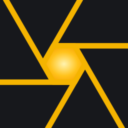

# Helios

> A client/server, AI-first image processing framework. Its first
> application is photo editing: the quality of darktable without having to
> learn darktable.

Helios builds on [darktable](https://www.darktable.org/)'s image processing
and turns it into a set of normalized, self-describing layers: a catalog
exposed as an API (the vault), a kernel that schedules work on any node
(laptop, GPU workstation, NAS, cloud), and several surfaces on top of a
single engine, including one where an AI assembles a small, pre-calibrated
workshop from an artistic intention.

**Status: early framework.** The first crates of the core exist (module
contract, graph, content-addressed evaluation, event bus) with one ported
module. Meanwhile, a catalog SDK inside darktable itself is built in the
[darktable fork](https://github.com/quazardous/darktable) on the
`helios/phase0-catalog-sdk` branch, with its design in `doc/helios/PHASE0.md`.

## Documentation

- [ROADMAP.md](./ROADMAP.md): vision, concepts, phases and open questions.
- [docs/NEEDS.md](./docs/NEEDS.md): the roadmap checked against real user needs,
  competitors and measurements.
- [docs/module-contract.md](./docs/module-contract.md): draft of what an
  image processing module is in Helios: isolated, pure, testable alone.
- [docs/architecture.md](./docs/architecture.md): draft of how the parts of
  Helios communicate: data on graph edges, commands to owners, a central bus
  for orchestration.
- [docs/testing-strategy.md](./docs/testing-strategy.md): draft of how Helios
  is tested and sandboxed, designed so that an AI agent can build it.
- [docs/gui.md](./docs/gui.md): GUI design notes: dockable panels, the node
  header, the queue panel, the graph view.
- [docs/ux-research.md](./docs/ux-research.md): what users ask of darktable's
  interface and its equivalents, real workflows, and scenarios for the GUI.
- [docs/vkdt-study.md](./docs/vkdt-study.md): how vkdt modules describe
  themselves and run, mapped onto the Helios module contract, with its
  generated [inventory](./docs/vkdt-inventory.md).
- [docs/iop-inventory.md](./docs/iop-inventory.md): what darktable's image
  operation modules already describe about themselves (introspection, widgets,
  tiling, OpenCL, scale awareness), as a baseline for module normalization.

## Code

A Cargo workspace (Rust):

- `crates/helios-core`: the domain-agnostic core: module contract and
  manifest, graph, an engine that evaluates a network without computing the
  same content twice, the event bus, `describe()` snapshots.
- `crates/helios-testkit`: synthetic images and contract tests generated
  from a module's manifest.
- `crates/helios-inspect`: the read-only inspection endpoint of a Helios
  process (state snapshots, bus events, waiting on an event) as JSON lines
  over a local socket.
- `crates/helios-photo`: the photo domain: raw mosaics and their color
  filter arrays, camera metadata as context, color spaces (linear Rec.2020
  working space).
- `crates/helios-vault`: the vault: images identified by content (BLAKE3),
  locations as data, folder import and repair scan, field commands and
  cursors, over an abstract store and its contract (an in-memory store
  for tests).
- `crates/helios-vault-sqlite`: the SQLite driver of the vault store.
- `crates/helios-load`: loaders, the framework reading files into sources:
  camera raws through rawler (sensor data and camera description), JPEG,
  PNG and TIFF pictures in the working space, embedded previews.
- `crates/helios-export`: exports, the leaves that write files: a node
  rendered, converted from the working space to sRGB, encoded (JPEG, PNG 8
  or 16-bit, TIFF 16-bit) and written atomically, as jobs that hold their
  destination so two writes to one file never race.
- `crates/helios-decision`: decision nodes: resolution modes (full AI,
  AI-assisted, human), recorded and versioned answers (who decided, which
  model, on which inputs), replayed offline into a network.
- `crates/helios-journal`: the workflow level: a journal per item and node
  (claims, leases, joins, choices, retries), after grampy, with a contract
  every storage must pass.
- `crates/helios-config`: settings declared once, resolved through layers
  (defaults, global, project, user, run), each value reported with its
  origin.
- `crates/helios-node`: `helios-node`, a headless node that loads a network
  from a JSON description, renders it and serves inspection; and `helios`,
  the command line (`helios inspect state`, `events`, `wait-event`,
  `wait-idle`; in debug builds `helios control render`, `set-param`,
  `pause`, `fault`...; `helios sandbox new|start|stop|clean` for isolated
  nodes); and `helios-mcp`, an MCP server giving an agent the same verbs,
  sandboxes included.
- `modules/sigmoid`: darktable's sigmoid tone mapper (per channel, hue
  preservation), ported.
- `modules/exposure`: darktable's exposure module (manual mode, camera bias
  compensation), ported.
- `modules/rawprepare`: darktable's rawprepare (black level and scale from
  the camera's description), ported.
- `modules/whitebalance`: darktable's white balance (as shot or user
  coefficients, on the mosaic), ported.
- `modules/highlights`: darktable's highlights, clip mode, ported.
- `modules/demosaic`: mosaic to camera RGB, bilinear for Bayer and X-Trans.
- `modules/colorin`: darktable's input color (camera matrix to the linear
  Rec.2020 working space), ported.

Build and test with `cargo test --workspace`.

## Tools

- `tools/iop_inventory.py`: regenerates the module inventory from a darktable
  checkout (`../darktable` by default, or `$DARKTABLE_SRC`).
- `tools/vkdt_inventory.py`: regenerates the vkdt module inventory from a vkdt
  checkout (`../vkdt` by default, or `$VKDT_SRC`).

Tooling that serves darktable itself (phase 0 SQL inventory, equivalence
bench) lives in the darktable fork under `tools/helios/`.

## License

GNU General Public License v3.0. See [LICENSE](./LICENSE). Helios links with
darktable, which is GPLv3.
