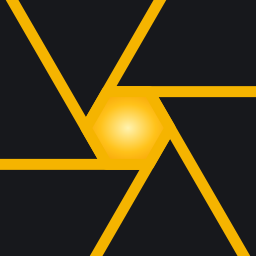

<p align="center"></p>

# Helios


> [!WARNING]
> 🚧 **Under construction: alpha.** Helios changes every day, its formats
> and settings may change without notice, and features are missing or
> unfinished. Try it on copies of your photos, keep your own backups, and
> expect bugs. Bug reports and ideas are welcome.

> A client/server, AI-first image processing framework. Its first
> application is photo editing: the quality of darktable without having to
> learn darktable.

Helios builds on [darktable](https://www.darktable.org/)'s image processing
and turns it into a set of normalized, self-describing layers: a catalog
exposed as an API (the vault), a kernel that schedules work on any node
(laptop, GPU workstation, NAS, cloud), and several surfaces on top of a
single engine, including one where an AI assembles a small, pre-calibrated
workshop from an artistic intention.

**Status: early framework.** The first crates of the core exist (module
contract, graph, content-addressed evaluation, event bus) with one ported
module. Meanwhile, a catalog SDK inside darktable itself is built in the
[darktable fork](https://github.com/quazardous/darktable) on the
`helios/phase0-catalog-sdk` branch, with its design in `doc/helios/PHASE0.md`.

The desktop interface is built on
[egui-pop](https://github.com/quazardous/egui-pop), an application framework
for [egui](https://github.com/emilk/egui) developed alongside Helios: its
workbench, commands, themes and kits, node graph, timeline and agent bridge
are what Helios's GUI is made of. Its
[web gallery](https://quazardous.github.io/egui-pop/gallery/) shows the
components live, and its
[first-app guide](https://github.com/quazardous/egui-pop/blob/main/docs/first-app.md)
follows the path Helios took.

## Download

Releases are published on the
[Releases page](https://github.com/quazardous/helios/releases), each with
its changelog. For Linux on x86_64:

- `Helios-<version>-x86_64.AppImage`: one file. Make it executable
  (`chmod +x`) and run it: it opens the window; `Helios-<version>-x86_64.AppImage
  helios ...` runs the command line.
- `helios-<version>-linux-x86_64.tar.gz`: a folder that runs where it is
  unpacked: `bin/helios-gui` (the window), `bin/helios` (the command line),
  with a desktop entry and icons under `share/`.
- `io.github.quazardous.Helios-<version>-x86_64.flatpak`: a Flatpak
  bundle, sandboxed: `flatpak install --user` it, then
  `flatpak run io.github.quazardous.Helios`. It sees the Pictures folder
  and removable media; see [docs/releases.md](./docs/releases.md#the-flatpak)
  for its permissions and how to grant another folder.
- `SHA256SUMS`: the checksums of every file (see [docs/releases.md](./docs/releases.md)).

Requirements: Linux x86_64 with glibc 2.35 or newer (Ubuntu 22.04, Debian
12, Fedora 36 and later), a Wayland or X11 desktop for the window. A GPU
with a Vulkan driver speeds the processing up; without one it runs on the
CPU.

For Windows on x86_64:

- `helios-<version>-windows-x86_64-setup.exe`: an installer, for the
  current user only (no administrator needed). It installs into
  `%LOCALAPPDATA%\Programs\Helios`, adds Helios to the Start menu, and
  uninstalls from Settings, Apps.
- `helios-<version>-windows-x86_64.zip`: the same programs as a folder that
  runs where it is unpacked: `helios-gui.exe` (the window), `helios.exe`
  (the command line).

It needs Windows 10 or 11 (64-bit); a GPU with a Vulkan or DirectX 12
driver speeds the processing up, without one it runs on the CPU. The
installer and the programs are not signed yet, so SmartScreen warns on
first start ("More info", then "Run anyway"): see
[docs/windows-port.md](./docs/windows-port.md) for what Windows still
lacks.

For macOS on Apple silicon (arm64):

- `helios-<version>-macos-arm64.dmg`: a disk image holding `Helios.app`.
  Open it and drag Helios onto Applications. The command line is inside
  the app: `/Applications/Helios.app/Contents/MacOS/helios`.

It needs macOS 11 or newer on an Apple silicon Mac; the GPU goes through
Metal. The app is not signed with a Developer ID nor notarised yet, so
macOS refuses the first start ("cannot be opened" or "damaged"): right-click
Helios in Applications, choose Open, then Open again (on macOS 15 and later,
open System Settings, Privacy & Security, and choose "Open Anyway"). Or
clear the quarantine flag in a terminal:

```bash
xattr -dr com.apple.quarantine /Applications/Helios.app
```

Building from source: see [CONTRIBUTING.md](./CONTRIBUTING.md).

## Documentation

- [ROADMAP.md](./ROADMAP.md): vision, concepts, phases and open questions.
- [docs/NEEDS.md](./docs/NEEDS.md): the roadmap checked against real user needs,
  competitors and measurements.
- [docs/module-contract.md](./docs/module-contract.md): draft of what an
  image processing module is in Helios: isolated, pure, testable alone.
- [docs/architecture.md](./docs/architecture.md): draft of how the parts of
  Helios communicate: data on graph edges, commands to owners, a central bus
  for orchestration.
- [docs/testing-strategy.md](./docs/testing-strategy.md): draft of how Helios
  is tested and sandboxed, designed so that an AI agent can build it.
- [docs/releases.md](./docs/releases.md): where releases come from, what
  they contain and how to check their checksums.
- [docs/bench.md](./docs/bench.md): the bench box, a remote runner for full
  builds, the test suite, timings and GPU tests (`cargo xtask bench-remote`).
- [docs/performance.md](./docs/performance.md): the performance budgets
  (thumbnails first) and the dated measurements against them.
- [docs/gui.md](./docs/gui.md): GUI design notes: dockable panels, the node
  header, the queue panel, the graph view.
- [docs/ux-research.md](./docs/ux-research.md): what users ask of darktable's
  interface and its equivalents, real workflows, and scenarios for the GUI.
- [docs/vkdt-study.md](./docs/vkdt-study.md): how vkdt modules describe
  themselves and run, mapped onto the Helios module contract, with its
  generated [inventory](./docs/vkdt-inventory.md).
- [docs/iop-inventory.md](./docs/iop-inventory.md): what darktable's image
  operation modules already describe about themselves (introspection, widgets,
  tiling, OpenCL, scale awareness), as a baseline for module normalization.

## Code

A Cargo workspace (Rust):

- `crates/helios-core`: the domain-agnostic core: module contract and
  manifest, graph, an engine that evaluates a network without computing the
  same content twice, the event bus, `describe()` snapshots.
- `crates/helios-testkit`: synthetic images and contract tests generated
  from a module's manifest.
- `crates/helios-inspect`: the read-only inspection endpoint of a Helios
  process (state snapshots, bus events, waiting on an event) as JSON lines
  over a local socket.
- `crates/helios-photo`: the photo domain: raw mosaics and their color
  filter arrays, camera metadata as context, color spaces (linear Rec.2020
  working space).
- `crates/helios-vault`: the vault: images identified by content (BLAKE3),
  locations as data, folder import and repair scan, field commands and
  cursors, over an abstract store and its contract (an in-memory store
  for tests).
- `crates/helios-vault-sqlite`: the SQLite driver of the vault store.
- `crates/helios-storage`: the volumes files live on (disks, cards,
  shares): identity, kind, roles, Linux detection, and the registry of
  those the vault knows.
- `crates/helios-connect`: import connectors: the trait every import
  source implements (paged listing with a cursor, items, access, fetch),
  their manifests and registry, the folder and card connectors, and the
  contract suite they pass.
- `crates/helios-load`: loaders, the framework reading files into sources:
  camera raws through rawler (sensor data and camera description), JPEG,
  PNG and TIFF pictures in the working space, embedded previews.
- `crates/helios-xmp`: darktable XMP sidecars read into Helios: history,
  params decoded with darktable's own layouts (`layouts.json`, from
  `tools/dt_param_layouts.sh`), mapped to Helios modules with a report of
  what is not carried over.
- `crates/helios-vkdt`: vkdt module files (`params`, `connectors`,
  `params.ui`) read into Helios manifests and written back unchanged.
- `crates/helios-gpu`: the GPU backend on wgpu: modules' WGSL variants run
  on the same plans as their CPU code and are checked against it.
- `crates/helios-compute`: compute units: the local machine's CPU and GPUs
  (and declared remote nodes), their machine-scope settings (enabled,
  role, priority, budgets), a calibration benchmark, and routing a job to
  a device with a CPU fallback; the `compute.*` commands.
- `packaging/linux`: the launcher and icons for GNOME and other freedesktop
  desktops (`install.sh` installs them for the current user).
- `crates/helios-shell`: the desktop shell's logic without a GUI toolkit:
  commands, `when` contexts, keymap layers, declared panels, workspace
  layouts.
- `crates/helios-export`: exports, the leaves that write files: a node
  rendered, converted from the working space to sRGB, encoded (JPEG, PNG 8
  or 16-bit, TIFF 16-bit) and written atomically, as jobs that hold their
  destination so two writes to one file never race.
- `crates/helios-decision`: decision nodes: resolution modes (full AI,
  AI-assisted, human), recorded and versioned answers (who decided, which
  model, on which inputs), replayed offline into a network.
- `crates/helios-journal`: the workflow level: a journal per item and node
  (claims, leases, joins, choices, retries), after grampy, with a contract
  every storage must pass.
- `crates/helios-config`: settings declared once, resolved through layers
  (defaults, global, project, user, run), each value reported with its
  origin.
- `crates/helios-node`: `helios-node`, a headless node that loads a network
  from a JSON description, renders it and serves inspection; and `helios`,
  the command line (`helios inspect state`, `events`, `wait-event`,
  `wait-idle`; in debug builds `helios control render`, `set-param`,
  `pause`, `fault`...; `helios sandbox new|start|stop|clean` for isolated
  nodes); and `helios-mcp`, an MCP server giving an agent the same verbs,
  sandboxes included.
- `modules/sigmoid`: darktable's sigmoid tone mapper (per channel, hue
  preservation), ported.
- `modules/blur`: a Gaussian blur whose radius is in full-resolution
  pixels, the same look at any render scale.
- `modules/exposure`: darktable's exposure module (manual mode, camera bias
  compensation), ported.
- `modules/rawprepare`: darktable's rawprepare (black level and scale from
  the camera's description), ported.
- `modules/whitebalance`: darktable's white balance (as shot or user
  coefficients, on the mosaic), ported.
- `modules/highlights`: darktable's highlights, clip mode, ported.
- `modules/demosaic`: mosaic to camera RGB, bilinear for Bayer and X-Trans.
- `modules/colorin`: darktable's input color (camera matrix to the linear
  Rec.2020 working space), ported.

Build and test with `cargo test --workspace`.

## Tools

- `tools/iop_inventory.py`: regenerates the module inventory from a darktable
  checkout (`../darktable` by default, or `$DARKTABLE_SRC`).
- `tools/vkdt_inventory.py`: regenerates the vkdt module inventory from a vkdt
  checkout (`../vkdt` by default, or `$VKDT_SRC`).

Tooling that serves darktable itself (phase 0 SQL inventory, equivalence
bench) lives in the darktable fork under `tools/helios/`.

## License

GNU General Public License v3.0. See [LICENSE](./LICENSE). Helios links with
darktable, which is GPLv3.

The modules ported from [vkdt](https://github.com/hanatos/vkdt)
(`modules/vkdt`) are also under vkdt's BSD-2-Clause licence: its copyright
notice and licence are in [modules/vkdt/LICENSE-vkdt](./modules/vkdt/LICENSE-vkdt),
and each ported file names the vkdt sources it comes from.

The default themes, Helios Dark and Helios Light, take their colours and
sizes from the design tokens of the [Rerun](https://github.com/rerun-io/rerun)
viewer's `re_ui` crate (MIT OR Apache-2.0, Copyright (c) Rerun Technologies
AB), through the Rerun-like kit of egui-pop; Helios is not affiliated with
or endorsed by Rerun.
