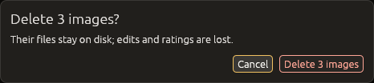
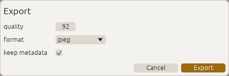
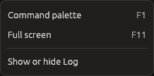
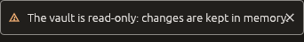
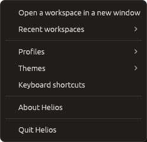
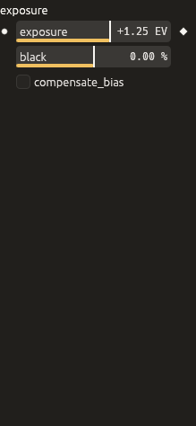
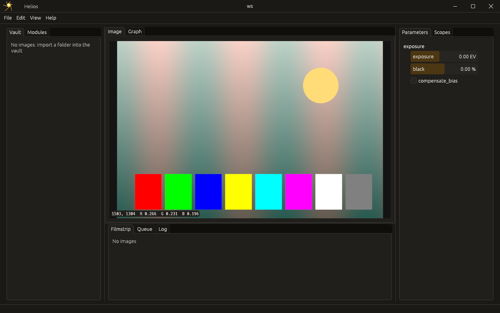
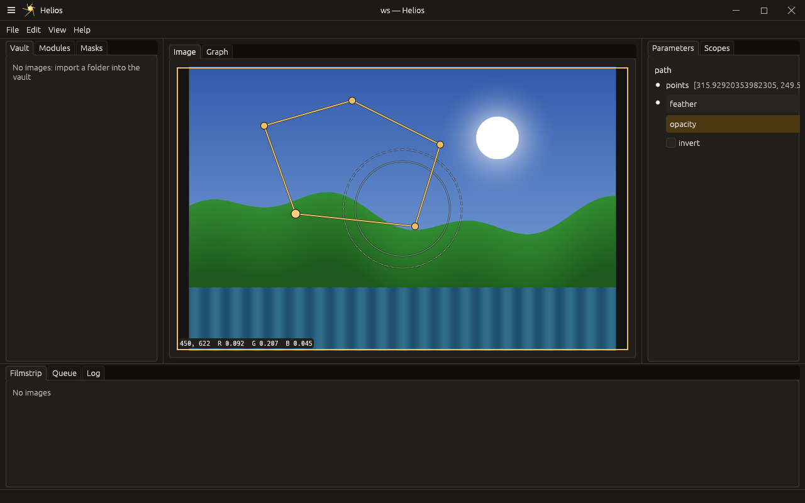
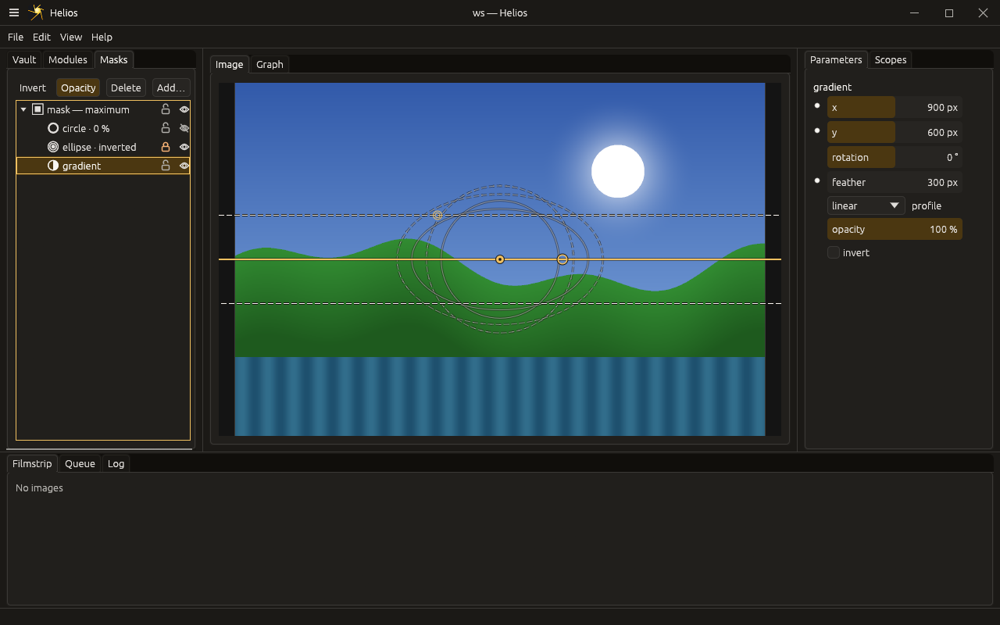

# GUI design notes

Status: **draft** (2026-10-11), from the review of the mockups. The toolkit
is egui on wgpu (decided 2026-10-11, ROADMAP section 2.1; the comparison
with iced is in [gui-prototype.md](gui-prototype.md)). Research behind
these notes: [ux-research.md](ux-research.md).

## Panels

Every panel can be moved, detached into its own window and docked anywhere,
as in VS Code: each user builds the view they want. Layouts are saved per
project workspace and follow the user (configuration, user scope). A
minimal image-first layout stays available for small screens.

**One window is one workspace (decided 2026-10-11).** A window holds one
project; another project opens another window. A detached panel opens an
auxiliary window of the same workspace: closing it docks the panel back,
closing the workspace closes them all. Each window follows the scale of
the screen it is on (a detached image on a 2x screen beside a main
window at 1x: both crisp, `tests/scale.rs`). Tabs live inside editor groups
(several graphs or images side by side), never at the project level.

The shell is a framework from the start:

- **areas**: editor groups (tabbed, splittable) in the centre, side and
  bottom panels, an activity bar, a status bar;
- **panels are declared** (id, title, default area, commands), so the shell
  places, saves and restores them and exposes them to shortcuts and the
  palette;
- **every action is a named command** (`view.graph.focus`,
  `panel.queue.toggle`), the same for menus, shortcuts, the command
  palette, agents (control API) and tests;
- **navigation by keyboard**: editor groups, tabs, the palette, quick open
  (an image, a node), a key per panel, cycling between areas; the map
  follows darktable's keys where they fit a clear credo, and is being
  researched;
- the layout, auxiliary windows and their screens included, is saved per
  workspace in the user scope.

Built on egui-pop's workbench (2026-10-12, `helios-gui/src/workbench.rs`):
Helios declares its panels with their rules (the areas each may be in,
the size it opens at, whether it detaches), and egui-pop docks them in
the centre, the start and end side bars and the bottom panel over
`egui_dock`, as tabs and splits, with auxiliary windows and tabs
dragged between areas; a drop the rules refuse is said where it
happens and in the status bar. The layout changes only through
egui-pop's steps (`workbench.move`, `workbench.focus`, `workbench.show`,
`workbench.hide`, `workbench.detach`, `workbench.attach`), which a
plugin may veto. Each panel has `<panel>.focus` and `<panel>.toggle`
(egui-pop's), and Helios's `<panel>.moveTo` (`area`: `center`,
`start_side`, `end_side`, `bottom`; the older `editors`,
`primary_side_bar`, `secondary_side_bar`, `bottom_panel` still read),
`<panel>.detach` and `<panel>.dock`.

The workspace's layout is egui-pop's layout document, one per workspace:
Helios's host names it (`Host::layout_document`:
`workspaces/<workspace>/layout` under `~/.config/helios/ui/`), egui-pop
loads it as the window opens and saves it as it closes, and
`Shell::switch_workspace` saves the layout left and loads the next
workspace's (`App::load_layout`). One saved by Helios before (no
version, the older area names, beside the workspace's profile) is
migrated when read.
**Arrangements** (egui-pop's) are named layouts saved, switched and
reset (`workbench.arrangement.*`), kept with the interface's settings;
Helios offers its own as templates: `Image`, the image-first layout
for small screens and culling (the image, the filmstrip under it,
every other panel closed).

**Palettes (2026-10-13).** The Masks panel, the Scopes and the
Navigator may float over the image as egui-pop's palettes (`PanelSpec::floatable`,
`helios_gui::FLOATABLE`): from their tab's menu (Float) or
`<panel>.float` (`pos`, else cascaded from the top left), never modal.
A palette is dragged by its header band (Pin, Roll up, Close), snaps to
the workbench's edges and to the other palettes, and docks back when
dropped on an area or by `<panel>.dock`. Tab (egui-pop's
`palettes.toggle`) hides and shows them while no field has the
keyboard. The Portrait retouch template opens with the Scopes floating
over the image, beside the Masks panel. Where they float is kept with
the workspace's layout.

## Settings pages

Settings pages are generated, never laid out by hand: a setting named
`page.group.name` appears on that page, in that group (see
[architecture.md](architecture.md), "Configuration"). Its widget comes from
its normalized input, the same description a module parameter has, so one
widget library draws both, and each widget shows where the effective value
comes from (default, global, project, user, run).

## Node header

Every node of a network shows the same header, whatever surface draws it.
The data comes from the framework (the module manifest and the engine's
node status), never from the GUI:

- **family** (a colour mark) and **type**: source, process, macro,
  decision, sink;
- **state**: idle, queued, running, waiting, done, stale, failed;
- **load**: queue depth, running, oldest waiting, retries due;
- **where it runs**: CPU, GPU, a remote node, an AI model.

`helios inspect describe node` already returns these headers for the
renders a node was asked for.

## Queue panel

When a node has a queue (workflow level, see
[architecture.md](architecture.md), "Two levels of execution"), a queue
panel shows it. The panel stays in the same place and follows the selected
node:

- a summary: mode, waiting and done counts, oldest wait, concurrency limit,
  retries due;
- one row per item (an image or anything else): state, since when,
  attempts, who or where (the user, a remote model, a GPU node, the job
  holding a lease).

For a node without a queue the panel stays in place with an empty state by
default; hiding it is a user setting.

## Graph view

- Layout is automatic and layered: nodes never overlap and edges do not
  cross; a node moved by hand pushes its neighbours instead of covering
  them.
- The graph and the darktable-like stack are two views of the same network
  and stay in sync.
- Edits use explicit actions (insert before, insert after, group as macro)
  rather than precise gestures.

### Principal nodes, stacks and semantic zoom

A network quickly grows past what a screen shows. Some nodes are principal
because the network turns around them; the others are stacked under them.

- **Overview** (zoomed out): only principal nodes and the links between
  their groups. Each principal node carries a stack badge (`+3`) and a header
  that aggregates its stack: the worst state (failed > waiting > stale >
  running > queued > done) and the total queue.
- **Detail** (zoomed in): stacks unfold into the full network. Zooming moves
  smoothly from one to the other; a single stack can also be unfolded in
  place.
- **Principal nodes are proposed automatically**: sources, merges (two
  inputs or more), decision nodes, sinks and the outputs of the network.
  Every other node is stacked under the principal node it leads to (its
  first consumer's group). The framework computes this (`Graph::layout`,
  shown by `helios inspect describe graph` as `layout`), with each node's
  rank for a layered layout, so every surface draws the same grouping.
- **Always overridable by hand**: pin a node as principal, fold one into a
  stack. These choices are a view: saved in the project workspace (user
  scope of the configuration), never in the network itself.
- A stack can be **promoted to a macro**, a real module made of a network
  (AVS style, see [module-contract.md](module-contract.md)), when it is
  worth reusing.

## Themes and profiles

Status: **decided** (2026-10-11). Research:
[profiles-research.md](profiles-research.md). Built: themes
(Helios's overlays of egui-pop's themes, in `helios-gui`, and their
commands) and profiles
(`helios-profile`, export, import with a diff, a workspace's profile).
Not yet: applying a theme's font families, the keyring API for plugins,
sync through the vault.

### Themes

- **The format.** A theme is a token file in the Design Tokens format
  (DTCG JSON), `*.helios-theme.json`, resolved by egui-pop (`egui_pop::theme`), the UI library
  Helios is built on; its token guide is the reference for the format,
  the tiers and the contract. The tokens are semantic:
  - surfaces: `surface.panel`, `surface.canvas`, `surface.overlay`;
  - text: `text.default`, `text.muted`;
  - `accent.default`, `danger`, `warning`, `success`, `info`;
  - sizes: `radius.widget`, `space.m`, `size.dialog.width`;
  - type: `font.size.body`, `font.family.ui`, `font.family.mono`;
  - component tokens: `button.*`, `dialog.*`, `toast.*`.
- **Helios's own tokens.** What egui-pop's contract does not have is a
  Helios component token, in each Helios theme: node states
  (`state.done`, `state.running`, `state.stale`, `state.failed`,
  `state.pending`), the destructive button (`button.danger.background`,
  `button.danger.text`) and the neutral surround behind a photo
  (`viewport.surround`). A theme without them falls back to the nearest
  egui-pop token. Still to come: module families (`family.tone`), graph
  wires.
- **Tokens only.** egui-pop maps tokens onto `egui::Visuals` and `Style`.
  A widget reads tokens (`Tokens::of(ctx)`), never a literal colour.
  egui's own fields are never saved, so an egui upgrade cannot break a
  theme. Unknown data goes under `$extensions` with the key
  `io.github.quazardous.helios`.
- **Inheritance.** A theme `$extends` a base. Helios Dark, Helios Light
  and Helios High Contrast are thin overlays of egui-pop's `pop-dark`,
  `pop-light` and `pop-high-contrast`. A plugin's theme may extend any
  installed theme. When a theme is missing, Helios falls back to Helios
  Dark and says so. Aliases (`{accent.default}`) let a theme change one
  colour and keep the rest consistent.
- **Overrides.** User overrides are a token file per theme, or for every
  theme, in the user's settings: the counterpart of VS Code's `[Theme]`
  keys and darktable's `user.css`. They are applied last and validated;
  unknown tokens are reported, not fatal.
- **Settings outside the theme.** Font size, interface zoom (egui-pop's,
  in fixed steps: `Ctrl+Alt+=`, `Ctrl+Alt+-`, `Ctrl+Alt+0`) and the
  dark/light/system preference are ordinary settings, so changing the
  theme does not undo them.
- **Live preview** in the theme picker. `theme.export` writes the current
  theme with its overrides merged into one file.

### Profiles

- **A profile is a named set of parts, each optional:**
  - settings of the `user` concern;
  - keymap layers (User);
  - theme and overrides;
  - panel layouts;
  - plugins;
  - export targets;
  - AI and workshop preferences.

  A part a profile leaves out comes from the **Default** profile. Several
  profiles per user (work, client, teaching).
- **Workspaces choose.** A workspace names its profile, as a VS Code
  folder does; the window title and status bar show it.
- **What stays out of profiles:**
  - presets and styles: a library of looks shared by every profile, so
    switching profiles never hides one;
  - the vault and its images;
  - settings of the `machine` concern;
  - secrets, which live in the OS keyring (Secret Service, Keychain,
    Windows credentials) behind a keyring API for plugins, and never in a
    file.
- **Export.** One readable file, `*.helios-profile` (TOML with a part per
  section), or only the chosen parts. Plugins are listed by id, pinned
  version, registry and enabled state, with their settings minus those
  their manifest marks `secret` or `machine`. A secret scanner runs before
  writing and refuses tokens that look like keys.
- **Import.** It shows what changes, part by part, as a diff, and lists
  the plugins to install with their capabilities, reviewed once for the
  set. It installs them in bulk from their registries; an optional signed
  bundle carries them for offline use. Any part can be left out.
- **Keymaps across systems.** Bindings use `Mod` (Ctrl on Linux and
  Windows, Cmd on macOS); a binding may still name a system. MIDI and
  controller bindings are a separate part, since devices differ between
  machines. The keymap part is the user's layer of egui-pop's keymap as
  a whole document (`export_keymap`, `load_keymap`, 2026-10-12): each
  binding keeps its `when` clause, a default key taken away is a
  `-<command>` entry without keys, and applying a profile says how many
  bindings changed and which keys conflict (egui-pop's `keys.load`
  step). Not yet: keys unbound from every command.
- **Variants per system or machine.** Any part may hold variants under
  `[on.<selector>]` (`[on.macos.theme]`, `[[on.machine.laptop.keymap]]`),
  overriding its common values. A selector is a system (`macos`, `linux`,
  `windows`), a screen class (`hidpi`: the screen's own scale is 1.5 or
  more, the interface zoom left out; followed when the window moves to
  another screen) or a named machine
  (`machine.<name>`); a machine is named once, in `machine.toml` in the
  config directory (`name = "laptop"`), never in a profile, never synced.
  A profile is resolved for this machine when applied: common values,
  then the system's, the screen class's, the machine's, the most specific
  winning. `profile.resolved` says which values came from which variant.
  Variants for other machines, or selectors Helios does not know, stay in
  the file unapplied. They travel with an export and show per selector in
  an import's diff; `profile.export` with `this_machine` writes only this
  machine's view, flattened. Machine settings never enter a profile,
  variants included.
- **Sync.** Later, through the vault (the user's own server), never a
  third-party service. Conflicts show as a diff per part, and the last 20
  versions are kept.

## Windows, dialogs and menus

**On egui-pop's application framework (2026-10-12).** The desktop is an
egui-pop application (`egui_pop::api::App`, with its `DefaultPlugins`):
egui-pop draws, from declarations, what every application shares, and
Helios declares into it:

- **the menu bar** (File, Edit, View, Help) and every menu, the
  **command palette** (`Ctrl+Shift+P`, `F1`: a fuzzy match, the recent
  commands first, a command's arguments asked for), the **dialogs**, the
  **toasts**, the **settings window** (`Ctrl+,`) with its **shortcuts
  editor** (a command's keys changed by pressing them, conflicts said,
  each change taken back by its reset) and the **window's place** (size,
  position, maximized, full screen with `F11` and a way out at the top
  edge), kept between runs with the interface's other settings (focus
  mode, the user's keys) under `~/.config/helios/ui/`. egui-pop opens
  the window (`run_native_with`: its place from the last run, repaired;
  the desktop's focus mode read) and closes it: Helios's `on_exit` saves
  the workspace's profile, then egui-pop's `app.exit` step saves the
  interface's settings, keys and the workspace's layout;
- **the window's frame** (egui-pop's `FramePlugin`, 2026-10-12): the
  title bar (the menu button, Helios's logo and name in the frame's
  `CAPTION_START` zone, the window's title, the minimize, maximize
  and close buttons) and resize edges never thinner than 6 physical
  pixels, drawn by Helios on the desktop; the `window.frame` setting
  gives the system's frame back. Its buttons are egui-pop's
  `frame.*` steps, which Helios's `window.minimize`, `window.maximize`
  and `window.close` commands run too;
- **keys**: egui-pop's keymap resolves them (layers, `when` clauses, a
  text field keeping plain keys), with the traces its debug bridge shows.

Helios keeps what is its own: its status line (a block of egui-pop's
status bar, beside the jobs item), its panels and their content
(egui-pop's workbench places them, see "Panels"), and its system menu.

**Commands run on Helios's kernel.** egui-pop wraps the kernel through a
host contract (`helios_gui::host`): every command of Helios's registry is
declared to egui-pop (its menus, palette, keymap and traces see it) and
runs on the registry, the control surface agents and scripts reach too.
A command whose work waits for the next frame shows as running until its
result arrives, and its failure is shown; egui-pop's events (a command
dispatched, done or failed, a dialog answered, a toast shown) go on
Helios's bus under `gui.*` kinds, with their sequence number, source and
cause, beside the engine's; events from elsewhere wake the window.

**Normalized (decided 2026-10-11).** Panels, widgets, modules and plugins
never draw a window, a popup, a menu or a dialog: they ask the shell
(`helios_gui::dialogs`), which hands them to egui-pop's components, the
same everywhere, drawn from the theme's tokens. A test fails if anything
else creates one (`crates/helios-gui/tests/normalized.rs`). Every open
dialog is also data: `dialog.current` describes it and `dialog.answer`
answers it, so an agent sees and answers what a human would, its origin
recorded.

- **Confirm**: a question, its consequences in one line, Cancel then the
  action on the right. The action is named by its verb ("Delete 3
  images", never "OK"). A destructive one uses the danger style and the
  focus starts on Cancel, so Enter does nothing harmful; otherwise Enter
  is the action and Escape cancels. `dialog.assumeYes` answers yes by
  policy, for scripts, and says so each time.

  

- **Form**: fields built from value descriptors (the value store's: type,
  range, steps, unit, choices), the same footer; never a free layout.
  Answered, it runs its command with the values.

  

  A **path field** (a descriptor made with `Descriptor::path`: a
  directory, or a file with its accepted extensions) is a text field and
  a Browse… button opening egui-pop's in-app picker inside the form: the
  folder, Up, home and the recent places, a filter field (or a typed
  path, Tab completing it), its subfolders (and the accepted files). A
  click on a folder opens it, on a file highlights it; Choose this folder,
  or Open (a double click), fills the field; Cancel goes back to the
  form. "Open a workspace" is such a form. Not yet: the system's chooser
  (egui-pop's now runs off the interface thread; Helios builds egui-pop
  without it), the recent workspaces offered first.

- **Picker**: a list to choose from, egui-pop's choice; its command runs
  with the value chosen. A filter field above the list narrows it as one
  types, the arrows move through it and Enter takes the highlighted
  entry.
- **Menu and context menu**: entries are commands, nothing else. Titles
  come from the commands, keys from the keymap, so a menu never shows a
  key that does not work; an entry whose `when` does not hold is greyed
  with the reason.

  

- **Notice**: shown in the status bar; warnings and errors also as a
  toast at the bottom right, with an optional action (a command). A
  notice never takes the focus; errors stay until dismissed.

  

- **Window**: auxiliary windows share the window's frame (title bar
  and buttons) when Helios draws it, titled "`<panel>` — `<window>`"
  (the main window's title: "Parameters — photos — Helios").

**Menus are declared** (egui-pop's menus): a menu is an id to which the
shell, a panel or a plugin contributes items, each a command (with
arguments and a label of its own), or a submenu. Items sit in ordered
groups, separated when shown; a `when` clause hides or greys an item, a
`checked` clause ticks it. `Shell::menu_items(id)` gives a menu as data,
as it would open now. The frame's menu button at the top left opens the
`helios.system` menu, as a right click on the title bar and Alt+Space
do: Helios replaces the frame's `frame.system_menu` step with a popup
of its own menu. It holds: open a workspace, recent workspaces,
profiles, themes (the one in use ticked), keyboard shortcuts, about,
quit (the window has its buttons). The profiles and recent workspaces
are lists filled when the menu opens (egui-pop's list providers).

**The palette and quick open (2026-10-13).** egui-pop's command palette
(`Ctrl+Shift+P`, `F1`) holds every command of Helios's registry with its
title, its category and its keys, as each is declared; only commands
that need an argument the palette cannot ask for well are left out
(`workbench.quickOpen.go`). Quick open (`workbench.quickOpen`, `Ctrl+P`)
is its companion for what is gone to by name, in the shell's picker
(egui-pop's choice dialog, filtered as one types):

- **modules**: the nodes of the network shown; choosing one selects it
  (`view/graph/selection`) and brings the Parameters panel forward;
- **images**: the library's, by file name; choosing one opens it in the
  viewport, as a launch or a `helios:` link would;
- **workspaces**: the recent ones; choosing one opens it in a window of
  its own.

Each entry runs `workbench.quickOpen.go` with its item
(`module:<node>`, `image:<id>`, `workspace:<path>`), which agents run
too.

The pictures are written by `HELIOS_DOC_PICTURES=$PWD/docs/gui cargo test
-p helios-gui --test dialogs pictures` (and `--test params pictures`), from
the repository's root: headless, never on the desktop.

## Jobs

What runs in the background shows in egui-pop's jobs centre (decided
2026-10-13): the Jobs panel (closed until asked for) and the popover of
the status bar's jobs item, the same list in both. Each job has its
title, a bar of its estimated overall percentage, "n of m", the current
step and item, the time left, why it failed, Cancel, and a chevron that
opens its log console (a terminal over the job's log lines,
`JobConsolesPlugin`). The status bar's item shows a ring with the
overall estimate and how many jobs go on or failed.

Helios's work reports through `helios_core::jobs` as `job.*` events on
the shell's bus, which egui-pop reads as its journal (see
[jobs.md](jobs.md)): an export (its render, encode and write steps, the
file written in its log), the library import (`library.import`: each
file as an item, a log line per file). Cancel runs `job.cancel` in the
desktop, which stops the job the way it gave when it started: an export
queued never runs, an export rendering writes nothing, an import stops
before its next file and removes a copy under way. The GPU calibration
reports as a job too (each device's reference modules, its speeds in the
log), once the desktop opens a compute manager, which it does not yet. A long export or batch
that ends while no Helios window has the focus is said on the desktop
(see "Platform services").

A running node's jobs show there too: `helios-gui --node
NAME=INSPECT[,CONTROL]` follows it (see [jobs.md](jobs.md), "A node's
jobs on the desktop"), its batch as a parent with its exports as
children, ids `node:<name>/<id>`; their Cancel goes to the node.

## Platform services

**On egui-pop's platform services (2026-10-13).** The desktop window adds
egui-pop's `platform` plugins (`helios_gui::platform::desktop`); tests,
pictures and tools build the shell without them. Helios's own part is
the `helios.platform` plugin, in every shell.

**One instance.** Helios runs once per user. `helios-gui` first asks
egui-pop's single instance (a local socket named after
`io.github.quazardous.Helios` and the user) whether Helios runs: if so it
hands over its arguments, its working directory and its activation token,
and exits. The running window comes to the front and opens what it was
given:

- a file (a path relative to the launch's directory, a `file://` URI, or
  `--image FILE`) shows in the viewport, imported into the vault when the
  window has one;
- a directory opens as a workspace, in a window of its own: one process
  per workspace, started with `--new-instance` so it does not hand itself
  back; the workspace already shown only comes to the front;
- a link: `helios://open?path=<absolute path>` (an image, or a workspace
  for a directory) and `helios://workspace?path=<absolute path>`, the
  path percent-encoded. A link with a relative path or another verb opens
  nothing (it is logged).

`--vault` in a later launch is ignored: the running window keeps its
vault. `helios-gui --new-instance` opens a window of its own, which does
not listen; later launches still go to the first window. The desktop file
(`packaging/linux`) passes URLs (`Exec=helios-gui %U`) and registers the
scheme (`MimeType=...;x-scheme-handler/helios;`); `install.sh` refreshes
the desktop database. On Wayland the window asks for attention rather
than taking the focus (egui does not hand the activation token on).

**Notifications.** A long export or batch (ten seconds or more) that
ends, finished or failed, while no Helios window has the focus (the main
one or a detached panel's) is said on the desktop: `Shell::job_finished`,
through egui-pop's notifications, tied to the desktop file by its id.
Its title (export or batch, finished or failed) is translated; its body is
the job's summary or error. The `notifications.jobs` setting ("Notify
when a long job ends", on by default) turns it off; egui-pop's
`notifications.desktop` setting still decides between the desktop and a
toast.

**Logs and crash reports** go to the user's state directory:

| | Logs | Crash reports |
|---|---|---|
| Linux | `$XDG_STATE_HOME/helios/logs/helios.log` (`~/.local/state/...`) | `$XDG_STATE_HOME/helios/crashes` |
| macOS | `~/Library/Logs/helios` | `~/Library/Application Support/helios/crashes` |
| Windows | `%LOCALAPPDATA%\helios\logs` | `%LOCALAPPDATA%\helios\crashes` |

The log file rotates at 5 MiB (three older files kept), at the
`developer.log_level` setting (`info` by default); egui-pop and the
window's own warnings write to it. A panic writes a crash report (the
version, the system, the backtrace, the last log lines and journal
events); the next start offers it in a toast. Nothing is sent. Help >
About Helios says where both are; the debug bridge's `logs` collector
gives the file, its level and its last lines, and the `logs.reveal`
command opens the folder.

**Not wired yet:**

- no export or batch runs in the window yet, so nothing calls
  `Shell::job_finished` today;
- the tray icon (egui-pop's `TrayPlugin`): off by default would need a
  setting read before the application is built, a tray menu and hiding
  to the tray on close, more than a few lines;
- global shortcuts (egui-pop's `SystemKeysPlugin`): the plugin starts a
  desktop backend (an X11 grab, the Wayland portal) as soon as it is
  added, so off by default needs the same setting read at start; no
  Helios command has a system-wide key yet;
- the window's app id (`helios-gui`) differs from the desktop file's
  name, which the Wayland global shortcuts portal and some notification
  servers match on;
- Helios's other crates write to the terminal (`eprintln!`), not to the
  log file.

## Parameters

Parameter widgets are generated from value descriptors and bound to the
value store (see [widgets.md](widgets.md)); a widget never holds its
value. A number is egui-pop's slider (`egui_pop::core::slider`, see its
guide `docs/sliders.md`) built from the descriptor: soft and hard
ranges, steps, unit, precision, the default to reset to, a logarithmic
bar when the module's hint asks for one, and a picker button at the
bar's end when the module declares a picker (its click publishes
`param.picker` with the path, for a picker tool to answer). A drag is one
gesture (one undo step; an agent's write meanwhile is refused; Ctrl
finer, Shift coarser; Escape gives it up and leaves no trace), the arrows
step (Shift coarse, Ctrl fine), a double click resets. The wheel
scrolls the panel: a slider takes the wheel only when it has focus or
while Alt is held, so scrolling past sliders never changes a value
(decided 2026-10-12, after darktable's most complained-about default).
Steps in a row on one slider (a held arrow's repeats, a turned wheel)
are one undo step; a held key repeats a step, never a command.
Enter types a value or an expression (`x * 2`, `x - 0,5`, `x` being the
value; units and either decimal mark accepted; past the soft range it is
forced up to the hard one, and says so); a click elsewhere drops what was
typed and lets go of the keyboard. Every finished change first runs
egui-pop's `slider.change` step (the slider named by the parameter's
path), where a plugin can veto it, snap it or follow it; then Helios
writes it to the value store as the user. Values are written in the
interface's language by egui-pop (`0,70 EV` in French). The scenarios of
`tests/input.rs` check
these rules with raw input events (wheel notches and touchpad streams,
drags across panels, double clicks, key repeats, focus). A dot on the left marks a value changed
from its default (click: reset); a diamond on the right, a value just
moved by someone else (the tooltip says who); an amber dot, a value held
by another origin's gesture. A list of numbers folds into a summary
(`12 points` for a path's or a brush's points, else `32 values`) that a
click opens below its row, a point a line: a long list never pushes the
next rows (a path's feather, a group's opacity) out of view. Each widget
is found by its path
(`param:<path>`), is a slider to assistive technology, and its context
menu resets, copies the path or copies the value.

**Curves and colour wheels (2026-10-13).** A list of floats whose hint
names an image tool (`ParamHint::widget`, carried by the descriptor) is
drawn by egui-pop's tool rather than folded into a summary:

- `ParamWidget::Curve`: egui-pop's curve editor over the points
  (`x0, y0, x1, y1, …` in 0..1; the list's count is twice the most
  points). A press on the curve adds a point and drags it, a double
  click or a right click on a point deletes it, a double click elsewhere
  goes back to the parameter's default; Page Up and Page Down select,
  the arrows move the selected point.
- `ParamWidget::Wheel`: egui-pop's offset wheel and its luminance slider
  over three values: the hue in turns, the chroma, the luminance
  (-1..1). A drag moves the puck relatively, a double click resets.

Each finished change runs egui-pop's step (`curve.change`,
`wheel.change`, named by the parameter's path; a plugin may veto or
redirect it), then is written as the user through the parameter's
descriptor (its range and count hold it): a drag as one gesture and one
undo step, keys in a row as one, Escape giving a drag up without a
trace. No module Helios ships declares one yet: the tools wait for a
tone curve and colour grading module.

## Image viewport

The image panel is egui-pop's viewport (`egui_pop::viewport`, decided
2026-10-11, built 2026-10-12): egui-pop draws, Helios supplies the pixels
and the colour (`helios-gui/src/viewport.rs`).

- **Pixels.** The engine is the viewport's tile source
  (`engine_source.rs`): a proxy of the whole image at a power of two
  first, then the exact tiles of what is visible at the view's scale,
  rendered on a thread of their own a union of neighbouring tiles at a
  time; a tile the view no longer needs is skipped. An edit renders
  again; the old tiles stay on screen until the new ones arrive.
- **Colour.** Tiles are linear Rec.2020 floats (the working space); the
  display transform, a matrix to sRGB primaries then egui-pop's clamp and
  encoding, runs in egui-pop's shader on the GPU.
- **The view** lives in the value store (`view/viewport/zoom`,
  `center_x`, `center_y`, `fit`), so commands, keys and agents move it.
  The zoom counts physical screen pixels per image pixel: 100 % is one
  image pixel on one screen pixel at any window scale. A drag is one
  gesture (an agent's write meanwhile is refused); none of it is an undo
  step nor saves the edit.
- **Gestures** are egui-pop's: a drag (the middle button anywhere, or
  Space and drag) pans and Escape puts it back, the wheel zooms around the
  pointer and stops at 100 % when it crosses it (Shift and the wheel
  pans), a double click fits; with the viewport focused, `+` and `-` walk
  the zoom ladder, `0` fits, `1` is 100 %, `2` is 200 %, the arrows pan. The commands
  `viewport.zoom.fit`, `viewport.zoom.100`, `viewport.zoom.in` and
  `viewport.zoom.out` do the same from the palette and for agents.
- **Before and after.** `viewport.compare` shows them side by side
  ("before" left of a split dragged by its handle, `view/viewport/split`);
  holding `\` shows "before" alone. "Before" is the edit as it was
  opened (not decided: the unedited image, or a snapshot taken by hand).
- **Readout.** The working-space R, G, B of the pixel under the pointer
  show in the bottom left corner.
- **Pictures.** `viewport.display` is what is on screen,
  `viewport.scene` the float data of the view before the display
  transform (`gui.snapshot`).

### Scopes and the histogram

The Scopes panel measures the pipeline's output, not the screen: a
preview of what the viewport shows (its node's output, the whole image,
its longest side at most 256 pixels, in the working space), rendered on
a thread of its own from the viewport's engine and cache each time the
graph changes (`helios_gui::preview`). The navigator draws the same
preview.

- **The histogram** is egui-pop's (`egui_pop::viewport::histogram`,
  2026-10-13): the red, green and blue counts on a log scale, in stops
  (`scopes.stops`, 16 stops wide) or linear (`scopes.linear`), and its
  clipping markers lit by the share of pixels at or below black and at
  or above white.
- **Dragging the histogram** moves the exposure (darktable's gesture):
  the `exposure` of the selected node when it is an exposure, else of
  the network's first. The exposure moves by as many stops as the
  histogram did, the pointer's way; the drag is one gesture (one undo
  step, other origins kept off), egui-pop's `histogram.drag` step runs
  at its release (a plugin may veto or change it), and Escape gives it
  up without a trace. Focused, the arrows step it.
- **The waveform and the RGB parade** stay Helios's own pictures
  (egui-pop has none).

### The navigator

The Navigator panel (`helios.navigator`, closed until asked for, in the
start side bar or floating as a palette) is egui-pop's zoom control and
navigator over the viewport's own state (2026-10-13,
`helios-gui/src/navigator.rs`): the whole image drawn from the preview,
a frame around the part in view and a veil over the rest; zoom out, the
zoom, zoom in, fit and 100 % above it.

- A drag of the frame pans (Ctrl finer, Shift coarser; Escape puts the
  view back), a click elsewhere centres the view there, the wheel zooms,
  a double click fits; focused, the arrows pan, `+` and `-` zoom, `0`
  fits.
- Each change goes through egui-pop's `zoom.change` step once finished
  (a plugin may veto or redirect it) and the viewport's `before_view`
  hook, then into `view/viewport/*`, where the viewport reads it: a
  drag is one gesture holding the view against other origins, and none
  of it is an undo step.

### Drawn masks

The viewport draws the shapes of the mask being edited (a `mask_combine`
node: `view/masks/mask`, the network's first by default) and edits them
(2026-10-12, `helios-gui/src/masks.rs`).

- **What shows.** Each shape's edge and the end of its feather (dashed),
  from `helios_module_masks::outline`, mapped to the screen by the
  viewport, all as egui-pop's overlays: the selected shape emphasized
  (`selected()`), the others faint (`faint()`), the feathers dashed.
  The selected shape's handles are egui-pop's handle kit (24-point
  targets): the centre (move), a radius (size), a rotation, the
  feather; a path's corners, and the Bézier handles of its selected
  point when they are off their corner (`HandleKind::Control`, their
  lines to the corner under the overlays). A gradient's rotation and feather handles sit at
  least 80 points along its line, clear of its anchor.
- **A drag** writes the parameters the handle moves through the value
  store, as one gesture: one undo step, held against agents meanwhile;
  Escape puts the values back and leaves no step. Shift constrains the
  angle (a rotation to 15° steps, a move to the axes and diagonals),
  Ctrl moves the handle a tenth of the pointer. A path's corner carries
  its handles; a Bézier handle's partner mirrors it.
- **Clicks.** A click on a shape's edge selects it (the Parameters panel
  follows), on a path's corner selects that point. A double click on the
  selected path's edge adds a point there, the curve kept; Delete removes
  the selected point (a path keeps three). A double click on a handle
  resets it (a rotation to 0, a feather to none, a corner to sharp); the
  wheel over a handle adjusts it (a size or feather, a rotation), one
  undo step while it turns. Elsewhere the viewport's grammar holds: the
  wheel zooms, a double click fits.
- **Hints.** While a handle is hovered, the status line says the
  gestures it takes, in the interface's language: what Shift snaps (an
  angle to 15° steps, or a move to the axes and diagonals), Ctrl's fine
  moves, and when they apply the double click's reset and the wheel.
- **Creating.** `mask.add.circle`, `mask.add.ellipse` and
  `mask.add.gradient` (`C`, `E`, `G` with the image focused) place a shape
  at the view's centre, sized to it; `mask.add.path` (`P`) starts the
  path tool: each click adds a corner, a click on the first one or Enter
  closes it, Escape gives up. The new node takes the mask's next free
  port.
- **State.** The mask, the shape and the point selected, the tool and the
  path being drawn are transient values (`view/masks/*`), never undo
  steps; the shapes' parameters are the nodes' (`node/<shape>/*`).
- **Agents** do the same through commands: `mask.select`, `mask.add.*`
  (with `params`, and `corners` for a path), `mask.path.close`,
  `mask.cancel`, `mask.point.add`, `mask.point.remove`,
  `mask.point.smooth`, `mask.handle.move` (one undo step).

Not yet: creating a shape is not an undo step and is not saved with the
image's edit (both change the network, which the value store does not
hold), shapes are deleted and reordered from the Masks panel only, and
the `--image` network has one mask (on its exposure).

The picture is a run of `helios-gui --image` in wbox, driven by its
keys and pointer: `C` for a circle, then `P`, five clicks and Enter for
a path. The path, selected, shows its edge and its handles; the circle
is drawn faint, its feather dashed.

### The Masks panel

The Masks panel (`helios.masks`, in the start side bar) shows the
selected module's mask network as a tree, on egui-pop's `TreeView`
(2026-10-13, `helios-gui/src/mask_tree.rs`):

- **What shows.** The module's mask (the group its `mask_blend` reads)
  is the root; each group (`mask_combine`) is a branch with its
  operator named by its effect (union for maximum, soft union for
  screen, intersection for minimum, multiply for product, add for sum,
  subtract from the first for difference, exclude for exclusion) and
  previewed before its row's eye: two soft discs folded by the
  operator, drawn in the theme's accent; each member a row with its icon beside it (circle, ellipse,
  gradient, path, brush, parametric, luminance, raster, AI object), and
  its inversion and opacity in its group when they are not the default,
  read from the group's per-port lists and said in words on its row
  ("inverted", "opacity 30 %", "hidden"; the root's own on its row).
  The refinements (blur, feather, levels) are rows of their own under
  what they refine: a member's between it and its group, the root's
  between it and the blend, after its members. So every node the engine
  renders for the mask shows (a test compares the panel's tree with the
  network rendered). Members are listed in port order, the order they
  fold in; a member wired to two ports of a group shows once per port,
  each row acting on its own port. Each row ends with an
  eye and a lock, which act on that row without selecting it. The selected module
  is `view/graph/selection`: a masked module shows its mask, a mask's
  node the mask it is in, and an unmasked one the first masked module's;
  a line above the tree names the module masked ("Mask of exposure").
  A mask with no member applies the module everywhere, and says so above
  the tree rather than leaving a lone row that looks broken.
- **Live.** The tree is read from the graph and the value store every
  frame, and what changed reaches the view through its `TreeHandle`:
  a shape drawn on the viewport, an agent's write, an undo, a member
  moved show at once, the open branches and the selection kept.
- **Selection, both ways.** Selecting a shape in the tree selects it on
  the viewport (its handles, the Parameters panel), its group becoming
  the mask the viewport edits; selecting a group makes it that mask.
  Selecting a refinement shows its parameters in the Parameters panel;
  it is not inverted, hidden, locked or moved (no eye or lock on its
  row, and a drag of it is refused).
  A shape selected on the viewport, by a click or `mask.select`, is
  selected in the tree.
- **Edits.** F2 renames a member in place: a label in the store
  (`label/<node>`), the node keeping its name, one undo step; the field
  starts from the name, not from the row's decorations. Labels and
  locks are saved with the image's edit (its `marks`) and come back
  when it opens again. Invert and
  Opacity (the row of buttons) toggle the selected member's inversion
  and its opacity (none or full) in its group, one undo step each; for
  the root, the group's own. A row's context menu (`helios.masks.row`,
  a right click) runs the same commands on that row's member, whatever
  is selected, and adds members (Add); its entries are short verbs
  (Rename…, Invert, Opacity off or full, Lock or unlock, Take out of
  the mask), filled when it opens in the interface's language, while
  the palette keeps the commands' titles with their arguments. A row's eye turns its member's
  opacity off or back to full; its lock (`lock/<node>`, one undo step)
  keeps a member from moving, from leaving the mask and, for a shape,
  from being edited (no handles on the viewport, `mask.handle.move`
  refused, no path point added, removed or smoothed), and keeps a group's members where they are. Take out (a button)
  or Delete (with the tree focused) takes the selected member out of
  its group; a right click only opens the row's menu, never deletes.
  A group that holds members is taken out only once a person confirms
  (a danger dialog, its members going with it while taking out is not an
  undo step); agents and the confirmed command
  (`mask.member.delete` with `confirmed: true`) are not asked.
  The buttons and the line naming the mask say their keys and gestures
  when hovered (F2, Delete, drag and drop, `C`, `E`, `G`, `P` on the
  image), in the interface's language. A member dragged
  before, after or into a group is rewired there, its opacity and
  inversion with it; a drop the network cannot take (beside the root,
  into a shape, into a full group or into itself, a locked member or
  group) is refused by the
  tree (`TreeView::can_drop`): the target is marked while dragging, and
  dropped there nothing moves and the reason is shown. Add… adds a shape or a
  parametric member (which reads the masked module's input) to the
  selected group.
- **Agents** do the same through `mask.member.move`, `mask.member.delete`,
  `mask.member.invert`, `mask.member.opacity`, `mask.member.rename`,
  `mask.member.lock` and `mask.add.parametric`.

Not yet: moving, deleting and adding members change the network, which
the value store does not hold: they are not undo steps and are not saved
with the image's edit; an undo across them may give a group's opacities
and inversions to the members now on those ports. A deleted member stays
in the network, unconnected (the graph cannot remove a node yet), and
the Parameters panel still lists it. A drawn shape's own opacity and inversion (its parameters) are
not shown in the tree, only its group's for it.

The picture is a run of `helios-gui --image` in wbox: `C`, `E` and `G`
on the image, then in the Masks panel the ellipse inverted (Invert) and
locked (its row's lock), the circle hidden (its row's eye) and the
gradient selected.

The picture is a run of `helios-gui --image` in wbox (a headless nested
compositor). Beside the same run of the viewport it replaced, the image's
pixels differ by at most one code value (egui-pop's tiles are half
floats), 96 % not at all; the surround is now the theme's
`viewport.surround`, aliased to egui-pop's `viewport.background`.
